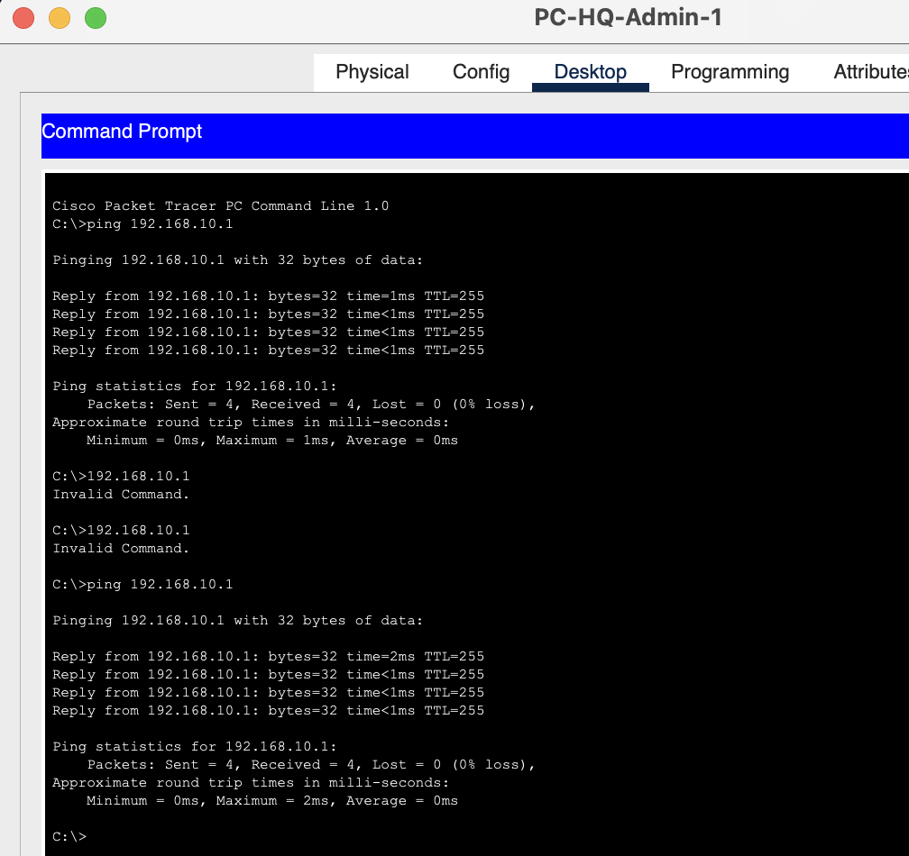

# Small Office Network – Cisco Packet Tracer

## Project Overview
A simulated network connecting a Head Office and Branch Office.

## Network Devices
- 2 Cisco 2911 routers
- 4 Cisco 2960 switches
- 8 computers
- 1 HQ server

## Network Testing
A ping test to 192.168.10.1 was successful with 0% packet loss.

## Tools Used
- Cisco Packet Tracer
- IPv4 addressing
- Ping troubleshooting

## Network Topology

## Network Topology

## Successful Ping Test

